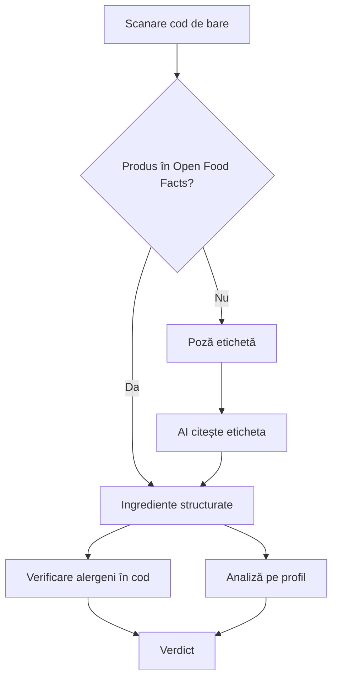

# IngrediScan (nume provizoriu)

Aplicație mobilă care îți spune dacă un produs alimentar e ok **pentru tine**, în funcție de alergiile, afecțiunile, medicamentele și analizele tale. Scanezi codul de bare sau faci poză la ingrediente și primești un verdict clar, cu explicații pe înțelesul omului.

---

## 1. Problema

- Majoritatea oamenilor nu înțeleg lista de ingrediente de pe ambalaj (E-uri, denumiri chimice, zahăr ascuns sub alte nume).
- Aplicațiile existente (Yuka, Open Food Facts) dau un **scor general**, același pentru toată lumea.
- Un produs „sănătos” în general poate fi o problemă pentru cineva cu diabet, boală renală, intoleranță la lactoză sau care ia anumite medicamente.

## 2. Ce aduce diferit

| | Yuka / Open Food Facts | IngrediScan |
|---|---|---|
| Scor | general, la fel pentru toți | verdict personalizat pe profil |
| Afecțiuni | nu | da |
| Medicamente | nu | da (interacțiuni aliment-medicament) |
| Analize medicale | nu | da (extensie licență) |
| Produse lipsă din bază | nu le poate evalua | fallback pe poză + AI |
| Explicații ingrediente | parțial | în limbaj natural |
| Etichete în română | variabil | da, prin AI |

Pe scurt: **Yuka îți spune dacă un produs e sănătos în general, IngrediScan îți spune dacă e ok pentru tine.**

## 3. Senzori folosiți

| Senzor | Rol | Status |
|---|---|---|
| Camera | scanare cod de bare, poză etichetă ingrediente, poză analize (licență) | obligatoriu |
| Touchscreen | toată interacțiunea cu aplicația (confirmat de profesor ca senzor) | obligatoriu |
| Face ID / biometric | deblocare aplicație, protejare date medicale | bonus |
| Microfon | întrebări vocale („pot să mănânc asta?”) | bonus, opțional |

## 4. Principiul de confidențialitate

**AI-ul nu are nevoie să știe cine e userul.**

- AI-ul e folosit ca **cititor de etichete**: primește poza, întoarce lista de ingrediente structurată (JSON) și explicații generale.
- Potrivirea cu profilul (alergii, afecțiuni, analize) se face **local / în backend**, cu reguli.
- Pentru cazurile nuanțate (medicamente, combinații de analize) se trimite **doar strictul necesar, anonimizat**: fără nume, CNP sau ID de user.
- Datele de sănătate se stochează criptat (pe telefon în `expo-secure-store`, în licență și în baza de date).
- Criptarea protejează împotriva scurgerilor de date. Minimizarea datelor trimise protejează față de furnizorul de AI. Sunt două probleme diferite, cu soluții diferite.

## 5. Fluxul principal de scanare

1. Userul scanează **codul de bare**.
2. Aplicația caută produsul în **Open Food Facts API**.
3. Dacă produsul **există**: se iau ingredientele, alergenii și valorile nutriționale.
4. Dacă produsul **nu există** sau datele sunt incomplete: userul face **poză la lista de ingrediente**, iar AI-ul o citește și întoarce ingredientele structurat.
5. **Verificare deterministă a alergenilor** (în cod, fără AI): caută alergenii din profil și sinonimele lor, plus mențiunile „poate conține urme de...”.
6. **Analiza personalizată**: reguli pe afecțiuni + AI pentru explicații și cazuri nuanțate.
7. Userul primește **verdictul**.



## 6. Verdictul

| Culoare | Înseamnă |
|---|---|
| 🟢 Verde | nicio problemă găsită pentru profilul tău |
| 🟡 Galben | de consumat cu moderație sau atenție (ex: zahăr adăugat, sare multă, interacțiune posibilă cu un medicament) |
| 🔴 Roșu | conține un alergen din profil sau ceva ce contravine clar unei afecțiuni |

Pe ecranul de rezultat:
- verdictul mare, vizibil
- motivul, în 1-2 propoziții
- lista de ingrediente cu cele problematice evidențiate
- explicație la tap pe orice ingredient (ex: „E471 = emulgator, de obicei din grăsimi vegetale”)
- disclaimer: *informații, nu sfaturi medicale*

## 7. Funcționalități

### 7.1 MVP laborator (obligatoriu)

- [ ] **Profil**: alergii, intoleranțe, afecțiuni, tip de dietă (vegetarian, vegan etc.)
- [ ] **Scanare cod de bare** cu `expo-camera`
- [ ] **Integrare Open Food Facts**
- [ ] **Fallback poză etichetă** + AI (Gemini API)
- [ ] **Verificare deterministă alergeni** (cei 14 alergeni majori din legislația UE: gluten, crustacee, ouă, pește, arahide, soia, lapte, fructe cu coajă, țelină, muștar, susan, sulfiți, lupin, moluște)
- [ ] **Ecran verdict** (verde / galben / roșu + explicație)
- [ ] **Istoric scanări**, salvat local (merge și offline)
- [ ] **Disclaimer** pe ecranul de start

### 7.2 Nice to have laborator

- [ ] Deblocare cu Face ID (`expo-local-authentication`)
- [ ] Explicație la tap pe fiecare ingredient
- [ ] Recunoaștere fructe / legume din poză (fără etichetă, informații generale)
- [ ] Medicamente în profil + avertismente de interacțiune

### 7.3 Extensii pentru licență

- [ ] **Backend Spring Boot**: conturi, profiluri, istoric sincronizat, proxy către Open Food Facts și AI (cheia API stă doar pe server)
- [ ] **Frontend web**: gestionare profil, istoric, statistici
- [ ] **Profiluri de familie**: un părinte gestionează profilul copilului
- [ ] **Analize medicale**:
  - upload PDF sau poză buletin
  - AI extrage valorile + intervalele de referință de pe buletin
  - userul **confirmă** valorile înainte de salvare
  - marcare automată a valorilor în afara intervalului (după intervalul de pe buletin, nu după judecata AI-ului)
  - analizele au dată și „expiră” (ex: avertisment după 6 luni)
  - datele de identificare (nume, CNP) se elimină înainte de trimiterea la AI
- [ ] **Interacțiuni aliment-medicament** complete
- [ ] **Capitol GDPR**: datele de sănătate sunt categorie specială de date personale
- [ ] **Capitol de evaluare** (vezi secțiunea 10)
- [ ] Opțional: **comparație Gemini vs model local** (ex: rulat cu Ollama pe laptop)

## 8. Stack tehnic

### Laborator
| Componentă | Tehnologie |
|---|---|
| Framework | React Native + Expo (TypeScript) |
| Rulare pe iPhone | Expo Go (nu necesită Mac) |
| Cameră + cod de bare | `expo-camera` |
| Stocare securizată | `expo-secure-store` |
| Biometric | `expo-local-authentication` |
| Bază de date produse | Open Food Facts API |
| AI | Gemini API |

**Atenție:** tot ce se folosește trebuie să meargă în Expo Go. Bibliotecile cu cod nativ custom (ex: ML Kit pentru OCR) cer un build nativ, iar pentru iOS asta înseamnă Mac sau cont Apple Developer plătit.

### Licență (în plus)
| Componentă | Tehnologie |
|---|---|
| Backend | Spring Boot |
| Bază de date | de decis (ex: PostgreSQL) |
| Frontend web | de decis |

## 9. Modelul de date (profil)

```
Profil
├── alergii[]            ex: arahide, lapte
├── intoleranțe[]        ex: lactoză
├── afecțiuni[]          ex: diabet tip 2, hipertensiune
├── dietă                ex: vegetarian
├── medicamente[]        (nice to have / licență)
└── analize[]            (licență)
    ├── dată
    ├── laborator
    └── valori[]
        ├── nume         ex: LDL colesterol
        ├── valoare
        ├── unitate
        └── interval_referință
```

## 10. Evaluare (pentru licență)

Set de test: 50-100 de produse reale din magazine românești + 20-30 de buletine de analize.

De măsurat:
- **Acoperire Open Food Facts**: câte produse sunt găsite și câte au ingredientele complete
- **Acuratețea citirii etichetelor** de către AI (ingrediente corecte / ratate / inventate)
- **Detectarea alergenilor**: verificarea deterministă vs AI (câți alergeni scapă fiecare)
- **Acuratețea extragerii valorilor** din buletinele de analize
- Opțional: **Gemini vs model local** (acuratețe + timp de răspuns)

## 11. Ecrane (wireframe-uri de făcut)

1. **Onboarding + disclaimer**
2. **Profil** (alergii, afecțiuni, dietă)
3. **Scanare** (camera + buton „fă poză la ingrediente”)
4. **Rezultat** (verdict + ingrediente + explicații)
5. **Istoric**

## 12. Riscuri

| Risc | Ce facem |
|---|---|
| AI-ul citește greșit eticheta sau inventează ingrediente | alergenii se verifică în cod, nu doar prin AI; userul vede lista citită |
| Open Food Facts are acoperire slabă pe produse românești | fallback pe poză; de testat înainte de design |
| Wi-Fi slab la demo | istoric offline, produse testate dinainte, hotspot de rezervă |
| Cheia API extrasă din aplicație | în licență, stă doar în backend |
| Furnizorul de AI vede date medicale | AI-ul primește doar etichete; profilul se trimite doar minim și anonimizat |
| Userul ia verdictul drept sfat medical | disclaimer + formulări de tip avertisment („discută cu medicul”) |
| Termenii Gemini la nivelul gratuit | de verificat dacă cererile pot fi folosite de Google pentru antrenare |

## 13. Pași următori

1. [ ] Caută 10 produse din casă pe openfoodfacts.org și notează câte sunt găsite și cât de complete sunt
2. [ ] Trimite 5 poze cu etichete românești la Gemini și verifică ce citește corect
3. [ ] Wireframe-uri brute pentru cele 5 ecrane (hârtie / tldraw / Excalidraw)
4. [ ] Schelet Expo: rulare pe iPhone prin Expo Go + scanare cod de bare funcțională
5. [ ] Integrare Open Food Facts
6. [ ] Fallback poză + Gemini
7. [ ] Profil + verificare alergeni + ecran verdict
8. [ ] Istoric
9. [ ] UI final

## 14. Întrebări deschise

- Pot folosi proiectul de laborator ca punct de plecare pentru licență? (de întrebat coordonatorul)
- Ce termeni are acum nivelul gratuit Gemini API pentru datele trimise?
- Ce bază de date și ce framework web pentru licență?
- Numele final al aplicației
